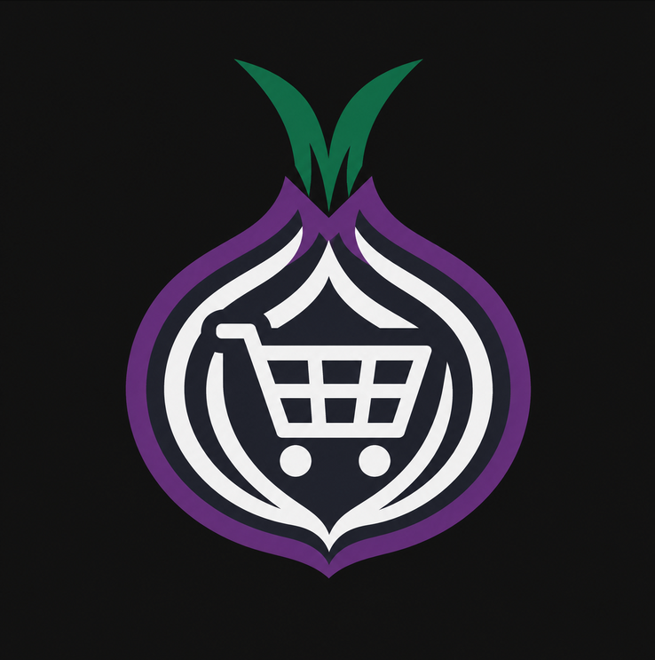

<p align="center">
  
</p>

# NodeMarket

A privacy-first, dependency-light e-commerce engine for independent stores.
Runs on Python + FastAPI + SQLite, renders pure HTML5/CSS, and ships with
**zero required JavaScript** on the storefront — everything (catalog, cart,
checkout, account-free ordering) works in the strictest browser security
modes, including Tor Browser at its highest security level.

## Screenshots


## Philosophy

- **Privacy-first, not privacy-decorated.** There is no analytics, no
  external CDN, no Google Fonts, no third-party calls, and no IP logging
  anywhere in the codebase. Access logging is disabled at the server level.
- **Zero-JS storefront.** Navigation, cart (signed HttpOnly cookie) and
  checkout are plain HTML forms with CSS. `script-src 'none'` is declared in
  the CSP so the site states its own no-script policy.
- **Data encrypted at rest by default.** Buyer delivery details are encrypted
  with the store owner's PGP public key *before* being written to the
  database. The server cannot read them — only the owner, with their private
  key, can.
- **Modular payments.** A small provider interface with built-in providers:
  a clean `demo` mode, self-contained Bitcoin (`btc`) via xpub BIP32
  derivation or Bitcoin Core RPC, Monero (`xmr`) via store addresses or
  monero-wallet-rpc — plus two configurable settlement modes
  (Direct-to-Seller and Temporary Escrow). See [Payments (v0.3)](#payments-v03).
- **Minimal stack.** Python 3.11+, FastAPI, Jinja2, SQLite. One `pip install`,
  one command to run.

## Install & run

```bash
git clone https://github.com/spekofc/NodeMarket
cd NodeMarket

python -m venv .venv
# Linux/macOS:
source .venv/bin/activate
# Windows (PowerShell):
#   .venv\Scripts\Activate.ps1

pip install -r requirements.txt

cp .env.example .env
#   edit .env: set SECRET_KEY and ADMIN_PASSWORD

python run.py
```

Open `http://127.0.0.1:8000`.

### First run as a store owner

1. Sign in at `/admin` with `ADMIN_PASSWORD`.
2. Go to **Settings**: set the store name, paste your ASCII-armored **PGP
   public key**, enable the payment methods you accept (Bitcoin, Monero,
   Demo) and pick the **settlement mode**. See
   [Payments (v0.3)](#payments-v03) below.
3. Add products under **Products** and group them with **Categories** —
   the storefront gets filter links (`/?category=slug`) and a plain-HTML
   search box (`/?q=`) automatically.
4. At checkout, buyer delivery details are PGP-encrypted automatically.
   Privacy purists can instead pre-encrypt their own details with their own
   key ("Bring your own PGP") — the server stores the block unreadable.
   View orders in the admin panel as ciphertext and decrypt them locally:

```bash
gpg --decrypt buyer-order.txt
```

## Docker deploy

The recommended way to run NodeMarket in production. The image is
`python:3.12-slim`, runs as a non-root user (`nodemarket`), and persists
everything in a volume at `/app/data`.

```bash
# build and run on http://127.0.0.1:8000
docker compose up -d --build

# generate a session secret and set it in docker-compose.yml before exposing anything
docker compose run --rm nodemarket python -c "import secrets; print(secrets.token_hex(32))"

# set the admin password: add ADMIN_PASSWORD to the environment: block, then
docker compose up -d
```

Plain `docker` without compose:

```bash
docker build -t nodemarket .
docker run -d -p 127.0.0.1:8000:8000 -v nodemarket_data:/app/data nodemarket
```

Configuration through environment variables (compose `environment:` block
or `docker run -e`): `SECRET_KEY`, `ADMIN_PASSWORD`, `STORE_NAME`,
`CURRENCY`, `DB_PATH` (keep the default `data/nodemarket.db` — the volume
mounts `/app/data`).

### Running as a Tor hidden service (`.onion`)

Uncomment the commented `tor` service in `docker-compose.yml`, change
`HOST` to `0.0.0.0` (Tor connects over the internal compose network, never
the host), and start:

```bash
docker compose up -d --build
docker compose exec tor cat /var/lib/tor/hidden_service/hostname   # your .onion URL
```

NodeMarket's zero-JS frontend works with Tor Browser at its highest
security level, and the app makes no external calls that would break
onion-service operation. See
[Transport security](#transport-security-read-before-deploying).

## Payments (v0.3)

### Methods (independently enabled in `/admin/settings`)

| Method | Address source (non-custodial) | Address source (custodial, optional) |
|---|---|---|
| **Bitcoin (BTC)** | `xpub` mode: unique P2WPKH (bech32) address derived per order via BIP32 public derivation — pure stdlib, no network calls, the server never sees a private key | `rpc` mode: local Bitcoin Core wallet issues `getnewaddress` per order (credentials in `.env`) |
| **Monero (XMR)** | store main address, or a pasteable list of subaddresses rotated per order (per-order addresses, no server wallet) | local `monero-wallet-rpc` creates a dedicated subaddress per order (credentials in `.env`) |
| **Demo** | no real payment — for testing | — |

Buyers pick a method with plain HTML radio buttons at checkout. No
exchange-rate API is ever contacted: the admin may set a manual
`1 fiat = N coins` rate per method, or show the fiat total only.

### Settlement modes

**Direct-to-Seller (non-custodial, default).** The checkout address belongs
to the seller's external wallet. The server holds no private keys, cannot
spend anything, and status tracking (`pending_payment → paid → completed`)
is manual bookkeeping. You are responsible for watching your own wallet and
marking payments as received.

**Temporary Escrow (custodial).** For storefronts that want to guarantee
delivery: the payment is received in an RPC-connected custodian wallet and
only moves to the seller after the buyer confirms receipt.

```
pending_payment ──> in_escrow ──> completed_released
                        │  ▲
                        ▼  │ (admin resolves)
                     disputed
pending_payment ──> cancelled (either mode, before settlement)
```

- The buyer confirms receipt on the order tracking page
  (`/order/<token>` — **Confirm receipt & release payment**, one click,
  zero JS, CSRF-hardened via the Origin check).
- On release, `EscrowEngine` (`app/payments/escrow.py`) fires an
  auto-payout hook that sweeps the custodian balance to the configured
  payout address via local RPC (`sendall` / `sweep_all`).
- If the RPC is not connected, the hook logs the pending payout in the
  escrow history and the admin pays out manually from the wallet —
  the release itself never depends on RPC availability.

**Security trade-off, stated plainly:** Direct-to-Seller means the server
operator *cannot* steal your funds but also *cannot* refund or guarantee
them. Temporary Escrow means the custodian wallet (your node, your keys)
holds funds for hours-to-days — it can spend them, so it must be yours and
must be kept safe. NodeMarket ships Direct as the default.

### Order tracking

No user accounts exist. At checkout each order gets a 128-bit random
tracking token: the URL `http://your-store/order/<token>` is the only
credential. It shows live status, the escrow history table (when in escrow
mode) and the release button while the order is `in_escrow`.

## Transport security (read before deploying)

NodeMarket encrypts buyer delivery data **at rest** (PGP, before the row is
written). It does **not** encrypt the hop between the buyer's browser and
your server — that is the operator's job:

- **HTTPS**: put a TLS-terminating reverse proxy (nginx, Caddy, Traefik…) in
  front of NodeMarket. Without TLS, delivery addresses and the order-tracking
  URL travel in cleartext from the browser to your server, where the PGP
  layer only then encrypts them for storage.
- **Tor hidden service (`.onion`)**: the zero-JS, no-logging design makes
  NodeMarket well suited to onion service deployment — no external calls, no
  CDNs, no analytics to break, and Tor Browser at its highest security level
  is a first-class client.
- Never expose NodeMarket directly over plain HTTP on a public IP. The
  default bind is `127.0.0.1` for exactly this reason; if you set
  `HOST=0.0.0.0`, you must have TLS or an onion service in front.

## Security model

| Layer | Behavior |
|---|---|
| Transport | **operator's responsibility**: serve behind HTTPS (reverse proxy) or as a Tor hidden service (`.onion`) — see [Transport security](#transport-security-read-before-deploying) |
|---|---|
| CSP | `default-src 'self'; script-src 'none'; frame-ancestors 'none'` |
| Referrer | `no-referrer` (header and meta) |
| Framing | `X-Frame-Options: DENY` |
| CSRF | SameSite=Lax cookies + cross-origin POST rejection (Origin check) |
| Sessions | itsdangerous-signed cookies, HttpOnly, SameSite=Lax |
| Admin auth | constant-time password comparison, 12h signed session |
| Captcha | self-hosted, zero-JS SVG challenge on admin login and checkout; answer lives only in process RAM, keyed by a single-use signed token with 5-minute expiry; no database state |
| JS detector | pure-CSS banner visible only when JavaScript is enabled (hidden via `<noscript><style>`), fully compatible with `script-src 'none'` |
| Rate limiting | in-memory sliding window on admin login, checkout and captcha routes; client addresses never touch disk or logs; automatic bucket sweep |
| Buyer data | PGP-encrypted before persistence; fail-closed checkout without a valid key |
| Logging | none — access log disabled, nothing about the requester is stored |

Out of scope by design (documented, not hidden): the CAPTCHA and rate-limit
stores are per-process (single uvicorn process; scale out behind a reverse
proxy if needed), no DDoS protection, no JavaScript-free image handling
beyond static files.

## Attribution / Forks

NodeMarket is AGPL-3.0. Forks and derived storefronts must keep the footer
attribution and preserve the same license. Please keep a visible link back:

```html
Powered by <a href="https://github.com/spekofc/NodeMarket" target="_blank" rel="noopener noreferrer">NodeMarket</a>
```

Badge for your README:

```markdown
[](https://github.com/spekofc/NodeMarket)
```

## Disclaimer

NodeMarket is a neutral, general-purpose software tool for operating an
electronic storefront. It is intended exclusively for lawful e-commerce and
data protection use. The authors are not responsible for how the software is
deployed or used. No party should use it where doing so would violate
applicable law.

## License

AGPL-3.0 — see [LICENSE](LICENSE).
